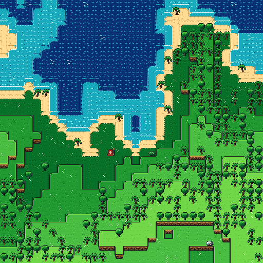
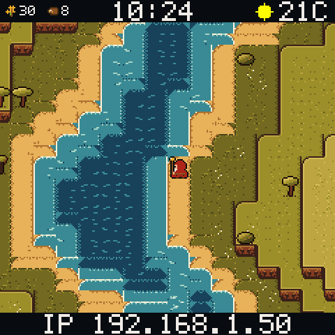
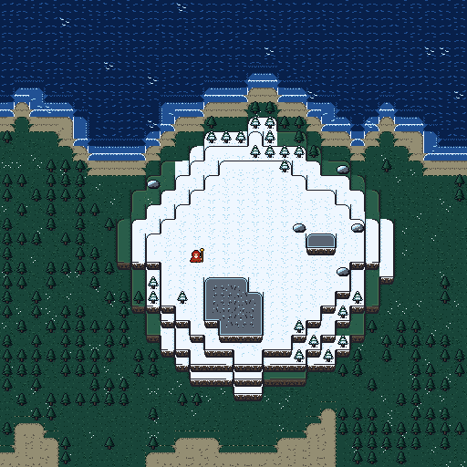

# MiniGodus

A self-playing god game for the GeekMagic 240x240 ESP8266 clock. A shaman, standing in for you,
spends the faith that villagers produce to reshape the land and to lay out homes, farms and
workshops. You never press anything: it is a clock with a little world in it. The full plan is in
[docs/DESIGN.md](docs/DESIGN.md).

**Status: release r2, the world.** The map now exists: a generated 32x32 world with stepped height layers, cliffs,
beaches, shores and snow, in four climates, with a camera that follows the shaman (a placeholder that wanders
on walkable ground and goes to bed). The top bar has the time, the weather and four counters (faith, food, wood,
population, placeholder values until r3), the bottom band adds "DAY n OF <world name>". Villagers, buildings and the
faith economy arrive in the next releases. The recovery layer, update page, rescue hotspot, WiFi, weather, time zone,
sleep schedule and flash saving are unchanged from r1.

**Download:** every build of the `main` branch is published on the
[Releases page](https://github.com/techconcert/MiniGodus/releases). Releases are named by number
(**MiniGodus r1**, r2, ...; the number lives in the `VERSION` file) and the newest is marked
"Latest". Each release has the two firmware files, `preview.html` (the game in your browser)
and `SHA256SUMS.txt`. The file names also carry the short commit, for example
`SDP_MiniGodus_quest_1-1a2b3c4.bin`.

## The world (r2)

Every world is made from one 32-bit seed (the clock's hardware random number generator picks it; a given seed always
gives the same world). The seed chooses one of six **landforms** and one of four **climates**, and a new world never
has the same landform and climate as the world before it (the last 4 worlds are kept in the save).

| Landform | Looks like |
|---|---|
| island | one island, terraces rising to the middle |
| coast | the sea on one side, land rising inland |
| river valley | a winding river with hills on both sides |
| lake basin | a lake in a bowl of hills |
| archipelago | 2 or 3 separate islands |
| mountain plateau | a terraced plateau with rock, lowland around it |

The map is 1 byte per tile: height 0 deep water, 1 shallow water, 2 beach, 3 to 6 land layers, 7 rock (unbuildable),
plus snow cover, soil and an object (tree, bush or fish, boulder). Climates are temperate, savanna, northern (snow
caps, pines) and tropical (palms); each has its own 16-colour palette, trees and resources.

Screens of the clock itself (the game core run on a PC, `tools/make_screenshots.py`), and the whole map of each landform:

| Island, temperate | Coast, tropical |
|---|---|
|  |  |
|  |  |

| River valley, savanna | Lake basin, northern |
|---|---|
|  |  |
|  |  |

| Archipelago, tropical | Mountain plateau, northern |
|---|---|
|  |  |
|  |  |

The four climates on the same island:

| Temperate | Savanna | Northern | Tropical |
|---|---|---|---|
|  |  |  |  |

How it is drawn: every 16x16 tile is four 8x8 quarters. A quarter looks at its own tile and the three tiles that touch
its corner and picks a piece of art for the pair of terrains (water/sand, sand/grass, grass/cliff, cliff/rock,
grass/snow, deep/shallow water). That gives rounded coasts and curved cliff corners from about 70 small pieces
of art. A step up draws a cliff face on its south side. The pieces are chosen once when the map changes, not per
frame; the 13 map strips are then redrawn from those tables while the camera scrolls pixel by pixel.

## Hardware

- GeekMagic SD Pro / SmallTV-style clock: ESP8266 (ESP-12, 4 MB flash) with a 240x240 ST7789
  display.
- Display wiring (from the [GeekMagic-Open-Firmware](https://github.com/Times-Z/GeekMagic-Open-Firmware)
  teardown): hardware SPI mode 3 at 40 MHz, MOSI 13, SCLK 14, DC 0, RST 2, CS tied to ground,
  backlight on GPIO 5 (active LOW).
- No serial adapter is needed or assumed. Everything is installed and recovered over WiFi.

## Builds

| File | What it is |
|---|---|
| `SDP_MiniGodus_quest_<version>.bin` | The game. |
| `SDP_MiniGodus_test_<version>.bin` | Display test: grass field, walking figure, RGB colour bars, FPS. Flash this first if you are unsure about colours. |

The names start with `SDP` because the stock updater only accepts such names.

## How to flash (over WiFi, no cable)

**First time, from the stock firmware:** open the clock's own web page, go to its firmware update
page and choose `SDP_MiniGodus_test_....bin` (or the quest file). Wait for the clock to restart.

**Later, from MiniGodus:** open `http://<clock IP>/update` (the IP address is on the clock's
bottom band and on your router's list), choose the new `.bin` and press **Upload and install**.
The page checks the file before uploading and shows its CRC32; the clock verifies the image again
before switching over. A failed or interrupted upload leaves the running firmware untouched.

Read [docs/RECOVERY.md](docs/RECOVERY.md) once, before the first install.

## The clock's web pages

Open `http://<clock IP>/`. The status page shows firmware, WiFi, network health, memory and
uptime. **Update firmware** and **Clock settings** are buttons in the first tile, **WiFi setup** is
in the Network tile.

**Update firmware** (`/update`): choose a `.bin` by hand, or press **Check for a new version**: your
browser (not the clock) asks GitHub (`techconcert/MiniGodus`) for `latest.json` on the `builds`
branch, tells you if a newer build exists, and **Download it** loads the file into the page for you;
you then press **Upload and install**. The clock itself never talks to GitHub. The same checks run on
the file as for a manual upload.

**Clock settings** (`/config`):

- **Weather:** search a city (foreign places work), or type latitude and longitude. Celsius is the
  default, Fahrenheit is an option. The clock asks [Open-Meteo](https://open-meteo.com/) (free, no
  account, plain HTTP) every 30 minutes and shows the icon and temperature on the top bar.
- **Sleep:** a sleep time and a wake time. The shaman walks to his bed, the screen and game go
  dark, the CPU slows down, and the clock keeps the time. At the wake time everything comes back by
  itself. **Sleep now** and **Wake now** buttons are there too. WiFi, the web pages and the update
  page stay on while asleep.
- **Location and time zone:** the city search also fills the time zone rule (converted in your
  browser, no firmware cost); you can still type the rule text by hand.
- **Screen:** brightness, colour depth, the weekly maintenance restart and the display test.
- **Save settings** and **Reset these settings** on this page touch only this page's settings.

The status page has a **Game settings** section (info card interval, quiet at night) with its own
Apply and **Reset game settings** buttons, which touch only those two settings.

## Recovery and the rescue hotspot

Every build contains, and CI refuses to produce a `.bin` without (`tools/check_bin.py`):

- **The update page starts first.** WiFi and the web server start before the display or the game,
  so a game bug cannot hide the update page.
- **Rescue hotspot** `MINIGODUS-XXXX`, password `MINIGODUS`, at `http://192.168.4.1/`. It is on for
  the first 10 minutes after every power-on and whenever the clock cannot find your WiFi. The
  WiFi page (`/wifi`) lets you enter your network again.
- **Crash-loop safe mode.** After 3 crashes in a row (or 5 in total without 6 hours of uptime in
  between) the clock boots without the game and shows SAFE MODE; after 6 it also skips the
  display. The update page still works.
- **Automatic restarts:** after hours without WiFi, with very low memory, and once a week at night.
  They never happen while a firmware upload is running, are rate limited, and count towards safe
  mode like any restart.
- **Size limit.** The ESP8266 holds the running firmware while receiving the next one, both inside
  a 1 MB area. CI fails any build over 500 KB, so updates always fit, including going back to
  stock.
- **Stock files are never touched.** Same flash layout as the stock firmware; the code never writes
  flash by itself (only the update page's Updater does), and CI forbids EEPROM, LittleFS and SPIFFS
  code. Flashing `SDPro_V1.0.6_....bin` from the MiniGodus update page brings the original clock
  back.
- **One flash area.** The clock saves its settings and the world in sectors 0x80000-0x82FFF (three
  4 KB sectors, between the running image and a staged update). Nothing else is ever written: not
  0x3FA000 (stock data), not 0xFF000, no EEPROM, LittleFS or SPIFFS. CI enforces this
  (`tools/lint_safety.py` rules L2 and L14). See "Saving to flash".

## Saving to flash

`firmware/store.cpp` keeps a ring log of 320-byte records (settings, weather and sleep settings, game)
in 36 slots over the three sectors. Each record has a CRC and a sequence number; the newest valid
one is loaded at boot, so a power cut in the middle of a write can never produce a half-saved state
(tested with random power cuts, see `test/test_slotlog.cpp`). Writes are rare: settings 5 seconds
after a change, the game every 20 minutes and at each new game day, at most 6 writes in 10 minutes;
every write is read back and 3 failures switch saving off. Nothing is written in safe mode, while a
firmware update runs, or when the image is larger than 0x7D000 bytes. After 2 or more crashes the
saved game is kept aside, not loaded, so a game that crashes the clock cannot crash it again from
the save. Updating to a new MiniGodus build keeps everything; flashing the stock firmware does not
(not needed). The status page shows "Saved to flash ..." or "Loaded from flash ..." lines.

**GeekQuest shares this flash area.** The clock's WiFi, weather and sleep settings are common to
both firmwares, but the saved game has its own magic number in each: MiniGodus' is `MGOD`
(`GQ_SAVE_MAGIC` in `lib/gamecore/src/gq_types.h`), GeekQuest's is `GGQS`. A game saved by the other
firmware fails the magic check and is ignored, so switching the clock between GeekQuest and MiniGodus
never loads the other's game; the next save simply replaces it. `test/test_save.cpp` checks this.

Gates: `tools/lint_safety.py`, `tools/check_bin_selftest.py`, `tools/check_bin.py` on every `.bin`,
a size report, and `tools/recovery_guard.py` (a `RECOVERY-CHANGE:` commit line and a new
`GQ_RECOVERY_REV` whenever a recovery file changes).

## Build and test

Firmware (PlatformIO, ESP8266 Arduino core):

```
pio run -e quest        # the game  -> dist/SDP_MiniGodus_quest_<version>.bin
pio run -e test         # display test build (the only one with the test scene)
```

Host tests (no ESP8266 needed; run every `test/*.cpp`):

```
for t in test/*.cpp; do
  g++ -std=c++17 -O1 -g -fsanitize=address,undefined -fno-sanitize-recover=all -Wall -Wextra -Werror \
    -o /tmp/$(basename $t .cpp) $t lib/gamecore/src/*.cpp lib/gqsafe/src/*.cpp && /tmp/$(basename $t .cpp) </dev/null
done
python3 tools/lint_safety.py && python3 tools/lint_safety.py --selftest
python3 tools/check_bin_selftest.py
```

Browser preview (clang with wasm32 and lld): `tools/build_preview.sh` writes `preview/dist/index.html`.
The preview is the same game core as the clock, plus a debug panel that is not in the firmware:
a seed picker (type a seed and press **Load seed** to see exactly that world), a **New world** button (random seed,
never the same landform and climate as before), menus to force a landform or climate, live weather, sleep mode,
WiFi state, jump to a day, and time scale.

Art: tiles and sprites are `assets/src/*.png` on a 16x16 grid with the 16-colour palette in
`tools/palette.py`. After editing run `python tools/png2tiles.py`. The r2 world art is made by
`python tools/make_world_art.py` (terrain quarters painted with roles, trees and boulders, the shaman, the top bar icons),
which you can also edit by hand afterwards; the climate palettes are in `tools/palette.py` too. The README pictures come
from `python tools/make_screenshots.py` (it builds `tools/shots.cpp`, a host renderer that uses the real game core).
Python tests: `python3 test/test_art_tools.py`.

## Repository layout

```
firmware/        ESP8266 entry (main.cpp), ST7789 driver, recovery layer (safety.cpp, netwatch.cpp), prefs.cpp,
                 weather (wxnet.cpp), sleep schedule (nightmode.cpp), settings page (config.cpp), flash save (store.cpp)
lib/gamecore/    portable game core (no heap, no libc), used by the firmware and the preview:
                 world.cpp (generator, autotiler), godus.cpp (scene, camera, shaman, top bar)
lib/gqsafe/      pure decision code of the recovery layer (boot counters, WiFi ladder, upload checks)
assets/src/      editable PNG sheets (terrain quarters, objects, shaman, icons, and the r1 sheets)
tools/           asset converter, version stamp, .bin safety checks, source lint, CI guards
firmware/config_page.h  source of the /config page; the firmware serves the gzip copy in config_page_gz.h (run tools/gen_config_gz.py after editing it, CI verifies)
docs/            design (DESIGN.md), the owner's recovery guide, screenshots/
preview/         browser preview (WebAssembly)
```

The `GQ_` prefix on code names (settings, events, queries) is a leftover from the project this
firmware grew out of and is kept so the recovery layer stays byte-for-byte comparable.
