# MiniGodus

A self-playing god game for the GeekMagic 240x240 ESP8266 clock. A shaman, standing in for you,
spends the faith that villagers produce to reshape the land and to lay out homes, farms and
workshops. You never press anything: it is a clock with a little world in it. The full plan is in
[docs/DESIGN.md](docs/DESIGN.md).

**Status: release r7, height-aware walking, a two-resource top bar and Switch Game Mode.** Nobody walks over a cliff any more: villagers and the shaman move only between equal layers or across ramps, and the shaman cuts ramps (CUTTING RAMPS) wherever the village needs a way between layers. The top bar shows two resources at a time (faith and population, then food and wood). The update page can switch the clock to GeekQuest or GeekQuestAI. Release r6 before it:

**Release r6, the monument and the end of the world.** A world now has an arc. The village grows to a town, the shaman raises a
monument in five stages with the faith the villagers have to spare, and when it is finished the next day is the worship day: everybody
gathers at the monument from dawn to dusk. Then a summary of the world (days, peak population, births, deaths, buildings) stays on the
screen until the next morning, and a new world starts from a new seed, very different from the last. The whole game is saved to flash
(every villager, building, the map with felled trees and saplings, the monument and the statistics), animals die and breed, and every
water body has a fish stock. The recovery layer, update page, rescue hotspot, WiFi, time zone and sleep schedule are unchanged (the only
recovery-contract edits are listed in RELEASE-NOTES.md and the PR).

**Download:** every build of the `main` branch is published on the
[Releases page](https://github.com/techconcert/MiniGodus/releases). Releases are named by number
(**MiniGodus r1**, r2, ...; the number lives in the `VERSION` file) and the newest is marked
"Latest". Each release has the two firmware files, `preview.html` (the game in your browser)
and `SHA256SUMS.txt`. The file names also carry the short commit, for example
`SDP_MiniGodus_quest_1-1a2b3c4.bin`.

## The world (r2)

Every world is made from one 32-bit seed (the clock's hardware random number generator picks it; a given seed always
gives the same world). The seed chooses one of six **landforms** and one of four **climates**, and a new world never
has the same landform and climate as the world before it (the last 4 worlds are kept in the save).

| Landform | Looks like |
|---|---|
| island | one island, terraces rising to the middle |
| coast | the sea on one side, land rising inland |
| river valley | a winding river with hills on both sides |
| lake basin | a lake in a bowl of hills |
| archipelago | 2 or 3 separate islands |
| mountain plateau | a terraced plateau with rock, lowland around it |

The map is 1 byte per tile: height 0 deep water, 1 shallow water, 2 beach, 3 to 6 land layers, 7 rock (unbuildable),
plus snow cover, soil and an object (tree, bush or fish, boulder). Climates are temperate, savanna, northern (snow
caps, pines) and tropical (palms); each has its own 16-colour palette, trees and resources.

Screens of the clock itself (the game core run on a PC, `tools/make_screenshots.py`), and the whole map of each landform:

| Island, temperate | Coast, tropical |
|---|---|
| 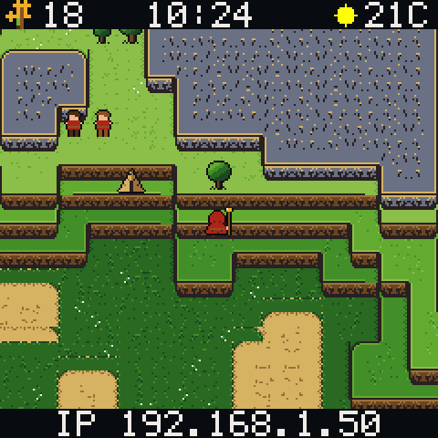 |  |
| 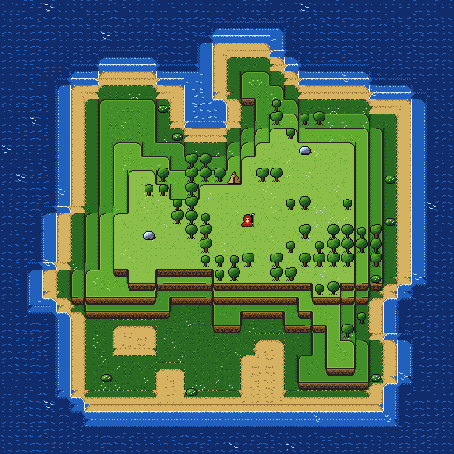 |  |

| River valley, savanna | Lake basin, northern |
|---|---|
|  |  |
| 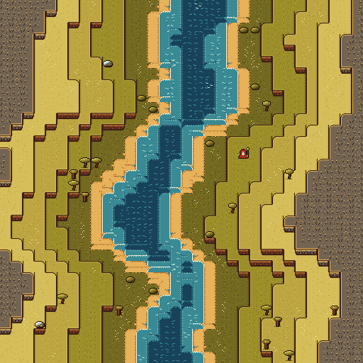 | 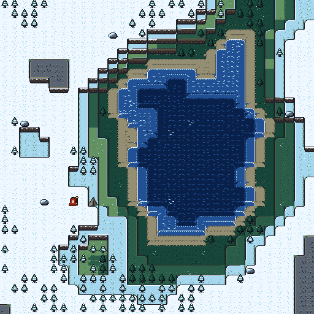 |

| Archipelago, tropical | Mountain plateau, northern |
|---|---|
|  |  |
|  |  |

The four climates on the same island:

| Temperate | Savanna | Northern | Tropical |
|---|---|---|---|
|  |  |  | 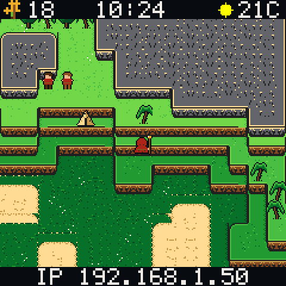 |

How it is drawn: every 16x16 tile is four 8x8 quarters. A quarter looks at its own tile and the three tiles that touch
its corner and picks a piece of art for the pair of terrains (water/sand, sand/grass, grass/cliff, cliff/rock,
grass/snow, deep/shallow water). That gives rounded coasts and curved cliff corners from about 70 small pieces
of art. A step up draws a cliff face on its south side. The pieces are chosen once when the map changes, not per
frame; the 13 map strips are then redrawn from those tables while the camera scrolls pixel by pixel.

## The village (r3)


| Village, tropical river valley | Village, northern island |
|---|---|
| 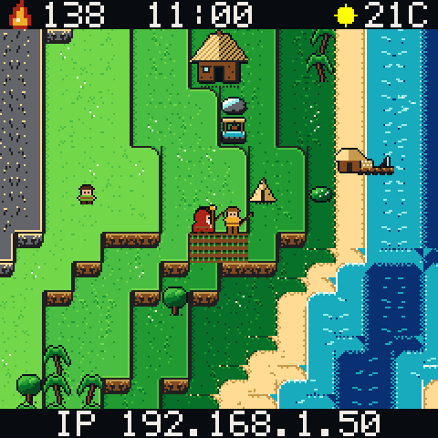 | 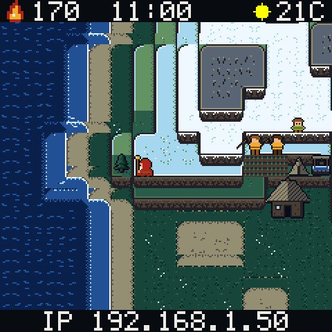 |

**People.** Up to 48 villagers, 6 bytes each. The game starts with one couple in a tent. A child grows up in 5 days; an adult
lives 20 to 28 days (the last 5 are spent as an elder, who prays). Villagers pair up (the k-th healthy woman with the k-th healthy man); a couple has a child about every 3 days, when there is a free
bed and two days of food to spare. Hunger is counted in missed meals: weak after 4,
death after 6 (7 with a healer awake). Thirst is satisfied at a well or on the shore; a water carrier fills a stock that
everybody can drink from.

**Jobs, chosen each morning by need.** Farmer (hoe, a wheat field), fisher (rod, fishing hut or shore), lumberjack (axe,
fells a tree, trees regrow a little every day), builder (hammer, builds the current site), healer (herbs), water
carrier (bucket), child (plays), elder (prays). Herders need pens, which come in a later release. Each job has its own
tunic colour and tool animation.

**Buildings.** Tent (2 beds), hut (4 beds), wheat field (three growth stages), well, fishing hut on a beach next to the water.
The planner puts a new building near the village green when the village needs it (a bed for everybody plus one spare, one field
per 5 people, a well, a fishing hut) and the wood is there; the builder works on it minute by minute. Faith is produced by awake adults every
30 minutes, elders count double.

**Time.** Everything runs on the clock's real time, so a game day is a real day. A longer jump of the clock (WiFi time
sync, power cut) is not played back, so a clock that was off never starves its village.

**Memory.** The village uses about 500 bytes of RAM. Pathfinding and the search for building sites share one 1 KB distance
buffer; the quarter-tile table is a window around the camera instead of the whole map, which saved more than the village needs.
The saved game (still 192 bytes) holds the first 16 villagers and 18 buildings, food, wood, faith and water; the full multi-slot
save is release r6.

The land itself got a pass in r3: heights come from fractal noise with a domain warp before the landform shape is applied,
so coasts and cliffs are irregular instead of nested rings, and a smoothing pass removes everything narrower than 2 tiles. Islands and archipelagos cover about half the map, with open sea along the border.

| Before (r2) | After (r3) |
|---|---|
| 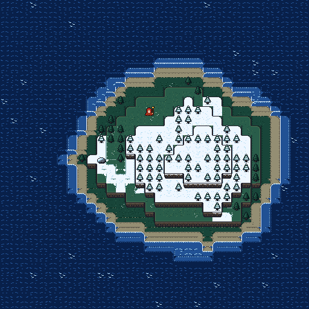 | 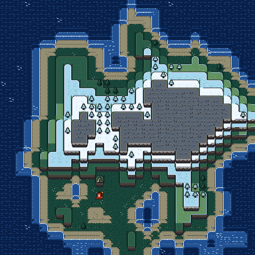 |
| 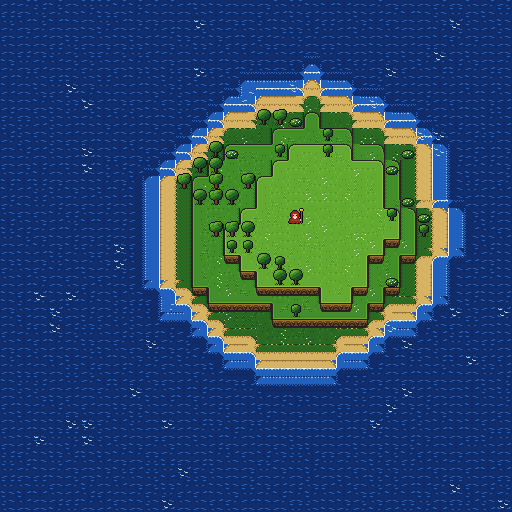 |  |
|  | 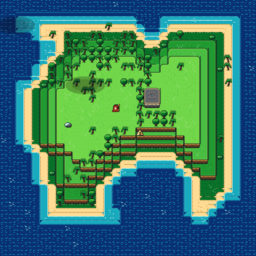 |

The top bar: 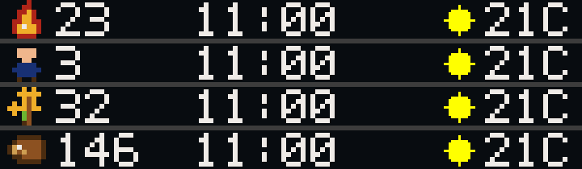

## The shaman (r4)


| A pond dug on a world without a coast | The town on day 20 (island, temperate) |
|---|---|
|  | 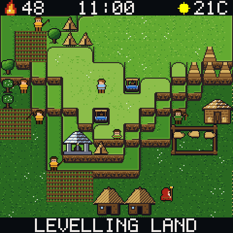 |

| Town on day 20, river valley, tropical | Town on day 20, lake basin, savanna |
|---|---|
|  | 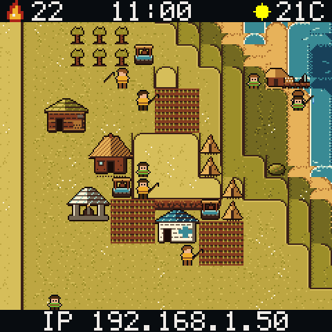 |

| Town on day 20, mountain plateau, northern | |
|---|---|
| 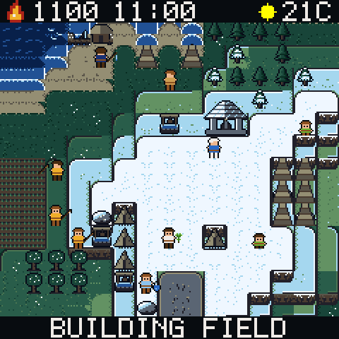 | |

**Needs and projects.** He scores food (less than 2 days of food, or too few fields), housing (fewer beds than people),
water (a home with no water within 8 tiles), health (the first sick villager wants an infirmary, r5),
wood, growth (a new home tier unlocked: a flat 3x3 plot beside the homes first, then the home), faith (no shrine) and
monument (a hook for r6). A pond has its own need when there is no coast. A world's seed decides his personality: farmer
(green robe), herder (sand), fisher (blue), builder (red). It biases the scores and the choice of food building.

**Terraforming.** One layer per cast. A step between two layers costs the number of the higher one, an object (tree,
rock) costs 1, rock layer 7 is never touched (rock is only the highest peaks: at most about 4% of the land, 10% on a mountain plateau). Faith is paid when the staff comes down and never goes below zero. Near the
village neighbouring tiles may differ by one layer only, and walking needs that too, so after a project he cuts ramps
(a ramp sprite marks them) until there is no cliff left that blocks a path. Buildings stand on one layer between 3 and 5,
never on the lowest land beside water and never on the keep-clear shore of a fishing hut; the site search takes the
spot of lowest cost (faith to level and ramp, 2 per tile of walking from the green, reserved-tile penalties) and refuses
any spot that would cut the village in two or shut another building in. Every single cast is checked as well: a step
that would cut the village in two or shut a building in is left out. Faith (up to 9999) is not hoarded: when more than 40% of a
reserve is spare he opens wide flat land around the green for the next tiers, towards forests and good soil, and digs a
second pond for fish (LEVELLING LAND on the band). A building that trees have shut in gets its trees cleared.

| Building | Size | From | Beds / yield |
|---|---|---|---|
| Tent | 1x1 | start | 2 beds |
| Hut | 2x2 | 6 villagers | 4 beds |
| Cottage | 3x2 or 2x3 | 14 | 6 beds |
| Manor | 3x3 | 24 | 8 beds |
| Wheat field | 2x2 to 3x3 | start | 8 grain per harvest |
| Orchard | 3x2 or 2x3 | 8 | 8 fruit per harvest |
| Animal pen | 3x2 to 3x3 | 10 | up to 10 animals (sheep, pigs, chickens), they breed when fed; a herder gets food from them |
| Fishing hut | 2x1 or 1x2 | on a shore | fish |
| Well | 1x1 | start | water |
| Lumberjack hut | 2x2 | 4 | more wood per tree |
| Granary | 2x2 | 10 | food cap +100 |
| Shrine | 2x2 | 6 | +1 faith per half hour, praying elders count 3 |
| Infirmary | 2x2 or 3x2 | first sick villager | heals in 1 day (3 days without an infirmary) |

A bigger home may replace tents and huts. Eating from three or more of the four food sources (grain, fruit, animal, fish)
in one day makes the village content: 25% more faith until midnight.

**Memory.** The shaman costs about 100 bytes of static RAM (project, reserved plots, last ramps) and the buildings table grew
from 32 to 40 entries; every search shares the one distance buffer. The saved game (still 192 bytes, version 4) now keeps each building's
size, but not the dug land: after a load the land is generated again and healed at once, free of charge.

## Weather, sickness and wood (r5)

The weather is the live Open-Meteo reading (WMO weather code and temperature, every 30 minutes). `wx_state()` in
`lib/gqsafe/src/wxparse.cpp` maps the code to the game's states: 0 to 3 clear or cloudy (windy above 29 km/h), 45 and 48 fog,
51 to 67 and 80 to 82 rain, 71 to 77, 85 and 86 snow, 95 to 99 thunderstorm. With no reading (no WiFi, a failed fetch) the game is
mild and dry: clear sky, 15 C, no rain, no shadows, no frost, no heat.

| Weather | On screen | In the game |
|---|---|---|
| Rain, drizzle | animated rain, puddles that gather on the low land and dry again | fields grow 50% faster, fishers catch 1 more, people working outside collect exposure |
| Thunderstorm | heavier slanted rain, a lightning bolt now and then that brightens one or two strips | like rain, and everybody goes home: nobody works outside while it lasts (they eat and drink at home) |
| Snow | falling snow; snow settles on the high layers in three steps (layer 6, then 5, then 4) and melts away again | fields stop, it counts as cold (firewood) |
| Above 28 C | | thirst comes twice as often, water carriers are hired in numbers (up to 3) |
| Below 8 C | | each occupied home burns 1 wood per night (chimney smoke until 09:00); lumberjacks come first; a home without wood is a cold home |
| Fog | haze, thicker at the top of the screen | none |
| Clear, cloudy, windy | cloud shadows drift over the land (2, 4 or 3 of them) | none |
| Night (the clock's sleep schedule) | the map is dimmed | everyone sleeps |

| Rain | Thunderstorm | Snow on the high layers |
|---|---|---|
| 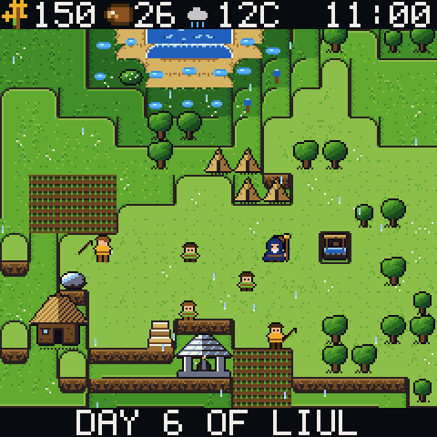 | 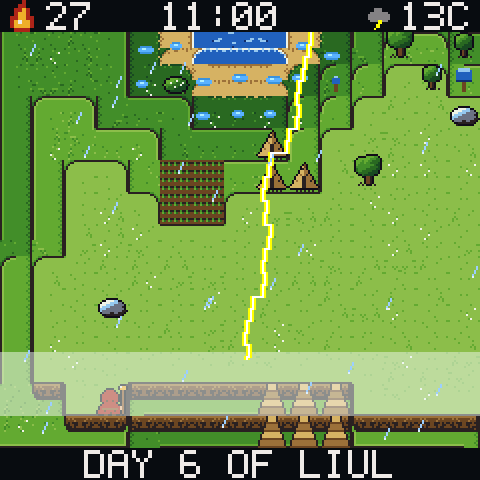 |  |

| Heat, water carriers | Cold night, chimney smoke | Fog |
|---|---|---|
|  | 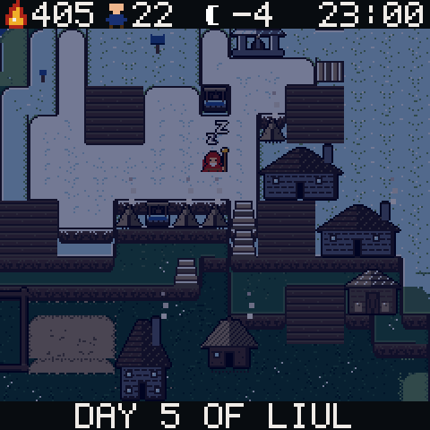 | 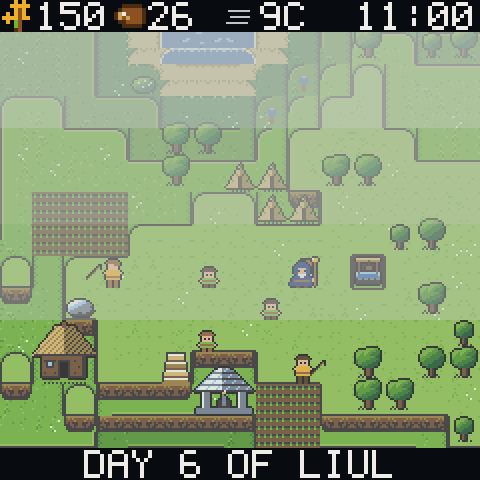 |

| Cloud shadows | An infirmary with a sick villager (green cross) | Lumberjack, stumps and saplings |
|---|---|---|
| 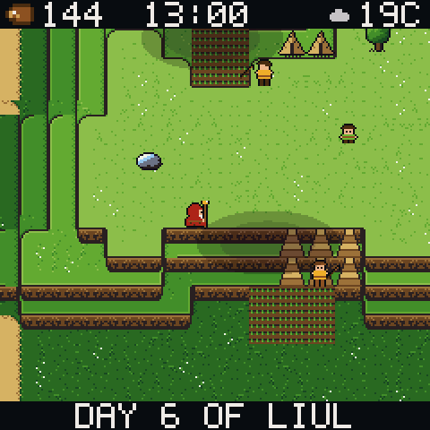 |  |  |

**Sickness.** Once a day, at midnight, every villager rolls against a risk of 1% plus: 3% for each missed meal (up to 3), a quarter of
a percent per thirst point, 2% per half hour spent outside in the rain (up to 10 half hours, 20%), 2% per hour outside in the cold (counted together), 12% for a night in a
cold home without wood, and 3% for elders and the weak. A sick villager does not work, walks to the infirmary and wears a green tunic and
a green cross. With an infirmary the sickness is over at the next midnight; with no infirmary it takes 3 days. Untreated, a sick elder or weak villager dies with a 25% chance at each midnight (6% in an infirmary with no healer);
healthy children and adults never die of it. A healer is hired as soon as somebody is sick and there is an infirmary. The shaman's health
need (the top of his list) builds the infirmary when the first villager falls sick, hunger alone does not call for one.

**Wood.** A lumberjack walks to a tree, fells it (3 wood, 4 with a lumberjack hut) and leaves a stump; his next swing plants a sapling on the
stump. A sapling becomes a tree after 4 to 5 days (never beside a building, on a reserved plot or on the green, never where the tree would shut a
path); a stump left alone rots away after 3 days. The forest also seeds saplings beside its own trees (up to 36 trees and saplings, more when the
forest is nearly gone). Lumberjacks leave the last 6 trees alone and never fell on a reserved plot or a project footprint.

**Debug commands** (`GQ_DBG_*` in `lib/gamecore/src/gq_types.h`, used by the tests and `tools/shots.cpp`; the browser preview's live weather menu does the
same through the normal reading): `GQ_DBG_WEATHER` forces a weather (and its top bar icon), `GQ_DBG_TEMP` forces the temperature in tenths of a degree,
`GQ_DBG_SICK` makes a villager sick, `GQ_DBG_AGE` makes one an elder or weak, `GQ_DBG_FLASH` strikes lightning now.

**Cost.** Rain and snow are 24 to 32 particles in one fixed array, moved every 150 ms and drawn into the strips that are being drawn anyway (the
map strips are redrawn about 6 to 7 times a second while it rains or snows; clear weather redraws only what changed, plus the slow cloud shadows).
Puddles, haze, shadows, the night dimming and the lightning are per strip, with no full-screen buffer.

**Memory and save.** The weather, sickness and forest add about 340 bytes of static RAM (sick state 48 bytes, snow map 128, saplings 32, particles 64,
shadows 8, counters). The saved game keeps 192 bytes, version 4: a villager's sick state is one more bit in the villager's record (old saves read
as healthy), so an r4 save loads. The weather itself, the snow, the stumps and the saplings are not saved (the weather comes from the live reading, and
the forest is regenerated from the seed on load), nor is the sickness of the villagers beyond the first 16.

**Known limits of r5:** the full multi-slot save is r6; felled trees, stumps and saplings are not saved, so after a restart the forest comes back as generated from the seed (r6's multi-slot save will keep them); a sick villager is
sick for the whole time (no partial recovery); the night dimming has no lit windows yet; weather does not stop the shaman casting; cloud shadows and the
night dimming are drawn over buildings and people as a flat tint.

## The monument and the end of the world (r6)

**Arc of a world.** Landing (days 1 to 3): a couple, a tent, a field. Village (4 to 12): children grow up, huts, a lumberjack, a shrine. Town
(13 to 24): cottages, pens, an orchard, a granary, ponds, manors, 20 to 30 villagers. The plot of the monument is marked out early (from day 5,
while there is still room). From day 21, with 28 villagers, the shaman saves his faith and raises it in five stages, one every 2 days at
the earliest, for 1300, 2200, 3200, 4500 and 6500 faith; only needs above 59 on his list (hunger, housing, water, sickness) come before it, and
his levelling of spare land pauses. The type is drawn from the seed: pyramid, stone circle, great tree, obelisk or temple.

| Pyramid | Stone circle | Great tree |
|---|---|---|
| 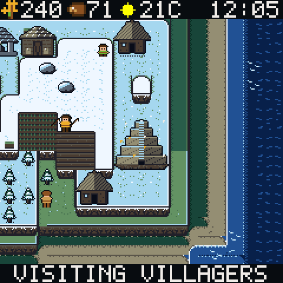 | 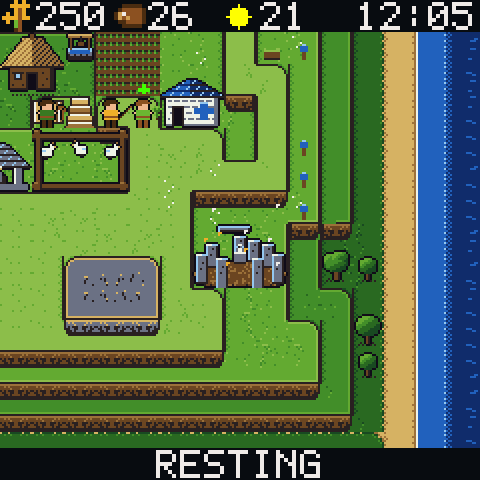 |  |

| Obelisk | Temple | Stage 3 of 5 |
|---|---|---|
|  |  | 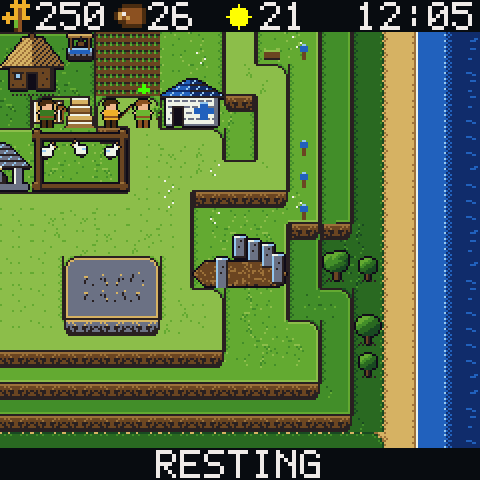 |

**Worship day.** There is no end date. When stage 5 stands, the next day (from midnight) is the worship day: all villagers, weak or not,
walk to the monument at dawn and stay until 20:00, the monument glows and the band reads WORSHIP DAY. After it the **summary** shows the world
name, days, peak villagers, births, deaths and buildings built. It stays until the next morning's wake time (the clock's sleep schedule still
darkens the screen at night), then a new world starts. If the village dies out the summary comes within minutes (THE VILLAGE IS GONE) and the new
world starts the next morning. The summary ends when your sleep schedule next wakes the clock (the built-in 06:00 without a schedule). Without a
valid clock it ends after about 12 hours of uptime.

| Worship day | Summary | Extinction | A town on day 35 |
|---|---|---|---|
|  |  | 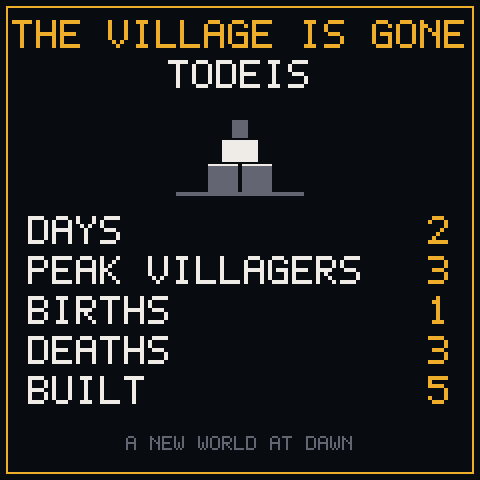 |  |

**New worlds.** The seed comes from the clock's entropy, the game clock and a counter. The last 4 worlds are remembered (in the save) and a new
world never has the same landform AND climate as the one before (`world_pick_hist` in `world.cpp`). The **Clock settings** page
(`/config`, linked from the status page) has a **Start a new world** button with a confirmation (`POST /config/world`); the new world starts at once and
is saved a few seconds later. The status page itself is part of the recovery layer and is not touched: see the PR for why the button lives on
the settings page.

**Growth and balance.** `python tools/balance_run.py` runs 100 whole worlds headless (the real core, weather simulated from the seed, 8 s of game
time per minute) and fails unless no world ends before day 30, the median end is on day 30 to 45 and at most 3% die out (CI: `balance.yml`).
Result of this release (seeds 1 to 100, 80 days at most):

| | min | p10 | median | p90 | max |
|---|---|---|---|---|---|
| end day (worship day over) | 33 | 35 | 37 | 41 | 51 |
| peak villagers | 36 | 42 | 48 | 48 | 48 |
| day stage 1 is finished | 22 | 22 | 22 | 23 | 33 |
| day stage 2 is finished | 24 | 24 | 24 | 26 | 35 |
| day stage 3 is finished | 26 | 26 | 26 | 30 | 39 |
| day stage 4 is finished | 28 | 29 | 31 | 35 | 44 |
| day stage 5 is finished | 33 | 35 | 37 | 41 | 51 |
| day the town has 20 villagers | 11 | 12 | 15 | 18 | 28 |
| villagers on day 20 | 8 | 23 | 35 | 44 | 47 |
| villagers on day 30 | 24 | 42 | 48 | 48 | 48 |

Extinct worlds: 0 of 100. The r5 plateau (towns stuck at 4 to 8 villagers with no wood) came from lumberjacks that could not reach any
tree: they now collect brushwood, saplings are planted 4 to 12 steps from the green when the forest near the village thins out, a couple's
children keep the sexes balanced, a young couple settles every 3 days while there is a free bed and food (up to 36 villagers), and a lone
couple forages berries when the stores run dry. Cottages and manors appear on their own from about day 12.

**Animals and fish.** Each animal in a pen dies of old age with a 3% chance a day, and after two lean days (food under 2 days for everybody) one
animal per pen and day starves. A pen with a herder and at least 3 days of food breeds one animal a day up to 10; a pen that lost its pair
gets a wild pair every 5th day while things are good. Every water body (sea, lake, river, pond) has a stock of 12 fish plus 2 per water tile
(at most 250); every catch takes one and the stock grows back by a tenth of its size each day, so a small pond is fished out quickly and
recovers in a few days.

**Debug commands** (`gq_types.h`, the browser preview's debug panel, `tools/shots.cpp`): `GQ_DBG_MONUMENT` (arg 0 to 5: the monument stands at that stage, laid
out if needed, no faith asked), `GQ_DBG_PHASE` (1 worship day now, 3 summary, 4 extinct summary, 0 back to play), `GQ_DBG_EXTINCT` (every villager dies).
`GQ_DBG_NEW_WORLD` and `GQ_DBG_SET_SEED` work as before.

**Memory and size.** The game core grows by 136 bytes of static RAM (stats, fish stocks, 3 new counters); the firmware's save code uses
fewer (the one 320-byte slot buffer, a 112-byte copy of the two settings records and a 36-byte scan table instead of 180). The monument art is
192 new 16x16 cells (row-deduplicated into `assets_gen.h`). See the build report of the release for the firmware size (cap 470 KB).

## Ramps, the top bar and Switch Game Mode (r7)

Height-aware walking: a step is allowed between equal layers, or between neighbouring layers when one of the two tiles is a ramp. The shaman cuts ramps (2 faith each) where the village needs access, and a village or a loaded game gets them free. Ramps are drawn as a stair; the figure walks along it.

| Villagers on a ramp (snow) | The shaman cutting a ramp |
|---|---|
| 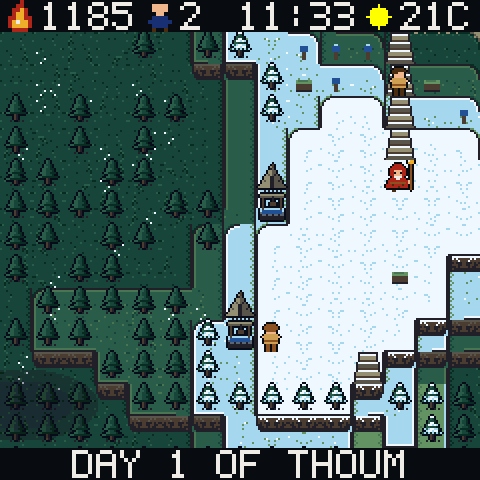 | 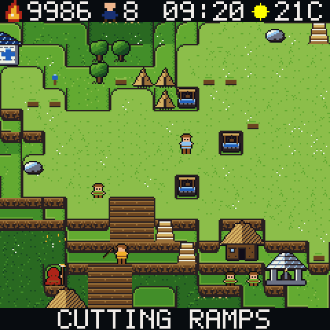 |

A terraced village, routing around cliffs by its ramps:

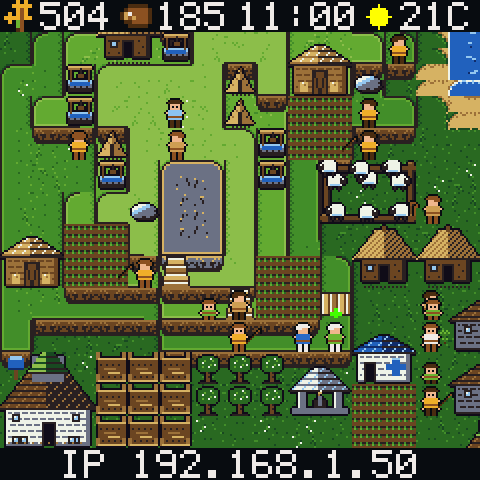

The top bar shows two resources, alternating every 3.5 seconds:


The worst case, 4 digits of faith, 2 of population and -10 C:


Switch Game Mode (the update page, under Firmware update): the buttons GeekQuest and GeekQuestAI make your browser read that game's `latest.json` on its `builds` branch and show its version; a second button, Switch to <game> <version>, downloads the `.bin`, checks it and installs it through the usual `/update` upload. Your saved MiniGodus world does not carry over.

## Hardware

- GeekMagic SD Pro / SmallTV-style clock: ESP8266 (ESP-12, 4 MB flash) with a 240x240 ST7789
  display.
- Display wiring (from the [GeekMagic-Open-Firmware](https://github.com/Times-Z/GeekMagic-Open-Firmware)
  teardown): hardware SPI mode 3 at 40 MHz, MOSI 13, SCLK 14, DC 0, RST 2, CS tied to ground,
  backlight on GPIO 5 (active LOW).
- No serial adapter is needed or assumed. Everything is installed and recovered over WiFi.

## Builds

| File | What it is |
|---|---|
| `SDP_MiniGodus_quest_<version>.bin` | The game. |
| `SDP_MiniGodus_test_<version>.bin` | Display test: grass field, walking figure, RGB colour bars, FPS. Flash this first if you are unsure about colours. |

The names start with `SDP` because the stock updater only accepts such names.

## How to flash (over WiFi, no cable)

**First time, from the stock firmware:** open the clock's own web page, go to its firmware update
page and choose `SDP_MiniGodus_test_....bin` (or the quest file). Wait for the clock to restart.

**Later, from MiniGodus:** open `http://<clock IP>/update` (the IP address is on the clock's
bottom band and on your router's list), choose the new `.bin` and press **Upload and install**.
The page checks the file before uploading and shows its CRC32; the clock verifies the image again
before switching over. A failed or interrupted upload leaves the running firmware untouched.

Read [docs/RECOVERY.md](docs/RECOVERY.md) once, before the first install.

## The clock's web pages

Open `http://<clock IP>/`. The status page shows firmware, WiFi, network health, memory and
uptime. **Update firmware** and **Clock settings** are buttons in the first tile, **WiFi setup** is
in the Network tile.

**Update firmware** (`/update`): choose a `.bin` by hand, or press **Check for a new version**: your
browser (not the clock) asks GitHub (`techconcert/MiniGodus`) for `latest.json` on the `builds`
branch, tells you if a newer build exists, and **Download it** loads the file into the page for you;
you then press **Upload and install**. The clock itself never talks to GitHub. The same checks run on
the file as for a manual upload.

**Clock settings** (`/config`):

- **Weather:** search a city (foreign places work), or type latitude and longitude. Celsius is the
  default, Fahrenheit is an option. The clock asks [Open-Meteo](https://open-meteo.com/) (free, no
  account, plain HTTP) every 30 minutes and shows the icon and temperature on the top bar.
- **Sleep:** a sleep time and a wake time. The shaman walks to his bed, the screen and game go
  dark, the CPU slows down, and the clock keeps the time. At the wake time everything comes back by
  itself. **Sleep now** and **Wake now** buttons are there too. WiFi, the web pages and the update
  page stay on while asleep.
- **Location and time zone:** the city search also fills the time zone rule (converted in your
  browser, no firmware cost); you can still type the rule text by hand.
- **Screen:** brightness, colour depth, the weekly maintenance restart and the display test.
- **Save settings** and **Reset these settings** on this page touch only this page's settings.

The status page has a **Game settings** section (info card interval, quiet at night) with its own
Apply and **Reset game settings** buttons, which touch only those two settings.

## Recovery and the rescue hotspot

Every build contains, and CI refuses to produce a `.bin` without (`tools/check_bin.py`):

- **The update page starts first.** WiFi and the web server start before the display or the game,
  so a game bug cannot hide the update page.
- **Rescue hotspot** `MINIGODUS-XXXX`, password `MINIGODUS`, at `http://192.168.4.1/`. It is on for
  the first 10 minutes after every power-on and whenever the clock cannot find your WiFi. The
  WiFi page (`/wifi`) lets you enter your network again.
- **Crash-loop safe mode.** After 3 crashes in a row (or 5 in total without 6 hours of uptime in
  between) the clock boots without the game and shows SAFE MODE; after 6 it also skips the
  display. The update page still works.
- **Automatic restarts:** after hours without WiFi, with very low memory, and once a week at night.
  They never happen while a firmware upload is running, are rate limited, and count towards safe
  mode like any restart.
- **Size limit.** The ESP8266 holds the running firmware while receiving the next one, both inside
  a 1 MB area. CI fails any build over 500 KB, so updates always fit, including going back to
  stock.
- **Stock files are never touched.** Same flash layout as the stock firmware; the code never writes
  flash by itself (only the update page's Updater does), and CI forbids EEPROM, LittleFS and SPIFFS
  code. Flashing `SDPro_V1.0.6_....bin` from the MiniGodus update page brings the original clock
  back.
- **One flash area.** The clock saves its settings and the world in sectors 0x80000-0x82FFF (three
  4 KB sectors, between the running image and a staged update). Nothing else is ever written: not
  0x3FA000 (stock data), not 0xFF000, no EEPROM, LittleFS or SPIFFS. CI enforces this
  (`tools/lint_safety.py` rules L2 and L14). See "Saving to flash".

## Saving to flash

`firmware/store.cpp` keeps a ring log of records in the three sectors 0x80000 to 0x82FFF. A record is 6 slots of 320 bytes
(`lib/gamecore/src/reclog.h`): settings (48 bytes), weather and sleep settings (64), and the whole game (1688 bytes, in 6 parts: the
head with the world, the statistics, the monument, the fish stocks and the seed history; then the villagers, the buildings and the map, 5 bits a
tile). Every slot has its own CRC, the record's sequence number and a CRC over all 1800 bytes; a record is valid only when
all 6 slots agree. The newest valid record is loaded at boot (the game is streamed into the core one slot at a time, so there is no 1.7 KB buffer),
and a power cut in the middle of a write leaves an invalid record, so the previous complete one loads (tested with power cuts at every kind
of point: `test/test_reclog.cpp` on the log, `test/test_store_sim.py` on the real store.cpp over a simulated flash). The erase only ever
takes the sector that holds the two oldest records, never the newest one or the one before it. Each sector is erased once per 6 saves
(about 12 times a day at a save every 20 minutes: 100 000 cycles last more than 20 years). Writes are rare: settings 5 seconds after a change,
the game every 20 minutes, at each new game day and 5 seconds after a new world, at most 6 writes in 10 minutes; every slot is read back, the whole
record is checked once more, and 3 failures switch saving off. Nothing is written in safe mode, while a firmware update runs, or when the image is
larger than 0x7D000 bytes. After 2 or more crashes the saved game is kept aside, not loaded, and the settings are still saved with the old game
carried over unchanged, so a game that crashes the clock cannot crash it again from the save. An r5 record (one slot, version 4 game) is still
read and upgraded by the first save. Updating to a new MiniGodus build keeps everything; flashing the stock firmware does not (not needed).
The status page shows "Saved to flash ..." or "Loaded from flash ..." lines.

**GeekQuest shares this flash area.** The clock's WiFi, weather and sleep settings are common to
both firmwares, but the saved game has its own magic number in each: MiniGodus' is `MGOD`
(`GQ_SAVE_MAGIC` in `lib/gamecore/src/gq_types.h`), GeekQuest's is `GGQS`. A game saved by the other
firmware fails the magic check and is ignored, so switching the clock between GeekQuest and MiniGodus
never loads the other's game; the next save simply replaces it. `test/test_save.cpp` checks this.

Gates: `tools/lint_safety.py`, `tools/check_bin_selftest.py`, `tools/check_bin.py` on every `.bin`,
a size report, and `tools/recovery_guard.py` (a `RECOVERY-CHANGE:` commit line and a new
`GQ_RECOVERY_REV` whenever a recovery file changes).

## Build and test

Firmware (PlatformIO, ESP8266 Arduino core):

```
pio run -e quest        # the game  -> dist/SDP_MiniGodus_quest_<version>.bin
pio run -e test         # display test build (the only one with the test scene)
```

Host tests (no ESP8266 needed; run every `test/*.cpp`):

```
for t in test/*.cpp; do
  g++ -std=c++17 -O1 -g -fsanitize=address,undefined -fno-sanitize-recover=all -Wall -Wextra -Werror \
    -o /tmp/$(basename $t .cpp) $t lib/gamecore/src/*.cpp lib/gqsafe/src/*.cpp && /tmp/$(basename $t .cpp) </dev/null
done
python3 tools/lint_safety.py && python3 tools/lint_safety.py --selftest
python3 tools/check_bin_selftest.py
for t in test/*.py; do python3 $t; done      # includes the store simulation (real store.cpp on a simulated flash) and the VERSION check
python3 tools/balance_run.py                 # 100 simulated worlds, a few minutes
```

Browser preview (clang with wasm32 and lld): `tools/build_preview.sh` writes `preview/dist/index.html`.
The preview is the same game core as the clock, plus a debug panel that is not in the firmware:
a seed picker (type a seed and press **Load seed** to see exactly that world), a monument stage, worship day, summary and extinction panel, a **New world** button (random seed,
never the same landform and climate as before), menus to force a landform or climate, live weather, sleep mode,
WiFi state, jump to a day, and time scale.

Art: tiles and sprites are `assets/src/*.png` on a 16x16 grid with the 16-colour palette in
`tools/palette.py`. After editing run `python tools/png2tiles.py`. The r2 world art is made by
`python tools/make_world_art.py` (terrain quarters painted with roles, trees and boulders, the shaman, the top bar icons),
which you can also edit by hand afterwards; the climate palettes are in `tools/palette.py` too. The README pictures come
from `python tools/make_screenshots.py` (it builds `tools/shots.cpp`, a host renderer that uses the real game core).
Python tests: `python3 test/test_art_tools.py`. The r4 building sprites (`village.png`, ids in `village_art_ids.h`) are drawn by the same script.

## Repository layout

```
firmware/        ESP8266 entry (main.cpp), ST7789 driver, recovery layer (safety.cpp, netwatch.cpp), prefs.cpp,
                 weather (wxnet.cpp), sleep schedule (nightmode.cpp), settings page (config.cpp), flash save (store.cpp)
lib/gamecore/    portable game core (no heap, no libc), used by the firmware and the preview:
                 world.cpp (generator, autotiler), godus.cpp (scene, camera, shaman's walk and staff, top bar),
                 village.cpp (villagers, buildings; shaman.inc.h is the shaman's brain: needs, site search, terraforming;
                 nature.inc.h: forest, fish; savepack.inc.h: the village's share of the saved game), reclog.cpp (flash record log)
lib/gqsafe/      pure decision code of the recovery layer (boot counters, WiFi ladder, upload checks)
assets/src/      editable PNG sheets (terrain quarters, objects, shaman, icons, and the r1 sheets)
tools/           asset converter, version stamp, .bin safety checks, source lint, CI guards
firmware/config_page.h  source of the /config page; the firmware serves the gzip copy in config_page_gz.h (run tools/gen_config_gz.py after editing it, CI verifies)
docs/            design (DESIGN.md), the owner's recovery guide, screenshots/
preview/         browser preview (WebAssembly)
```

The `GQ_` prefix on code names (settings, events, queries) is a leftover from the project this
firmware grew out of and is kept so the recovery layer stays byte-for-byte comparable.
