# MiniGodus

A self-playing god game for the GeekMagic 240x240 ESP8266 clock. A shaman, standing in for you, spends the faith that
villagers produce to reshape the land and to lay out homes, farms and workshops. You never press anything: it is a clock
with a little world in it, and the clock's real time is the game's time. The full plan is in [docs/DESIGN.md](docs/DESIGN.md).

**Current version: r8** (the number lives in the [`VERSION`](VERSION) file). What changed in each release is in
[RELEASE-NOTES.md](RELEASE-NOTES.md) and on the [GitHub Releases page](https://github.com/techconcert/MiniGodus/releases).

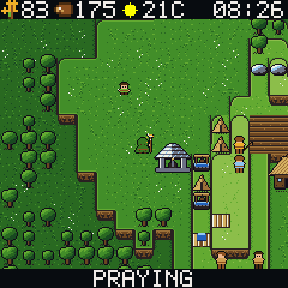

## Install and update

Every build of the `main` branch is published on the [Releases page](https://github.com/techconcert/MiniGodus/releases), named by number
(**MiniGodus r8**, ...); the newest is marked "Latest". Each release has the two firmware files, `preview.html` (the game in your browser)
and `SHA256SUMS.txt`. The file names also carry the short commit, for example `SDP_MiniGodus_quest_8-1a2b3c4.bin`.

| File | What it is |
|---|---|
| `SDP_MiniGodus_quest_<version>.bin` | The game. |
| `SDP_MiniGodus_test_<version>.bin` | Display test: grass field, walking figure, RGB colour bars, FPS. Flash this first if you are unsure about colours. |

The names start with `SDP` because the stock updater only accepts such names.

**First time, from the stock firmware:** open the clock's own web page, go to its firmware update page and choose
`SDP_MiniGodus_test_....bin` (or the quest file). Wait for the clock to restart. **Later, from MiniGodus:** open `http://<clock IP>/update`
(the IP address is on the clock's bottom band and on your router's list), choose the new `.bin` and press **Upload and install**, or press
**Check for a new version** (your browser asks GitHub, the clock never does) and **Download it**. The page checks the file before uploading
and the clock verifies the image again before switching over; a failed upload leaves the running firmware untouched. Read
[docs/RECOVERY.md](docs/RECOVERY.md) once, before the first install. The update page also has **Switch game mode**: buttons for GeekQuest and
GeekQuestAI that fetch that game's newest build and install it through the same checks (a saved MiniGodus world does not carry over).

## What you see

The top bar shows two resources on the left (faith and population, then food and wood, alternating every 3.5 seconds), the weather icon and
temperature, and the clock at the right edge with a gap of two character widths in front of it (the gap only shrinks, to about 13 pixels,
when 4-digit faith, 48 villagers and a three-character temperature leave no more room). The bottom band rotates through the status lines, the
day and the world's name, and always says what the shaman is doing.

| Faith and population | Food and wood |
|---|---|
|  |  |

The worst cases (the gap shrinks to what is free): 9999 faith, 48 villagers and -10 C; 999 food and 999 wood and -10 C; 999 faith, 48 villagers and 21 C.


## The world

Every world is made from one 32-bit seed (the clock's hardware random number generator picks it; a given seed always gives the same world).
The seed chooses one of six **landforms** and one of four **climates**, and a new world never has the same landform and climate as the world
before it (the last 4 worlds are kept in the save).

| Landform | Looks like |
|---|---|
| island | one island, terraces rising to the middle |
| coast | the sea on one side, land rising inland |
| river valley | a winding river with hills on both sides |
| lake basin | a lake in a bowl of hills |
| archipelago | 2 or 3 separate islands |
| mountain plateau | a terraced plateau with rock, lowland around it |

Climates are temperate, savanna, northern (snow caps, pines) and tropical (palms); each has its own 16-colour palette, trees and resources.
The map is 512x512 pixels (32x32 tiles of 16x16): height 0 deep water, 1 shallow water, 2 beach, 3 to 6 land layers, 7 rock (unbuildable), plus snow,
soil and an object (tree, bush or fish, boulder). The clock shows a 240x208 window of it that follows the shaman.

| Island, temperate | Coast, tropical | River valley, savanna |
|---|---|---|
|  | 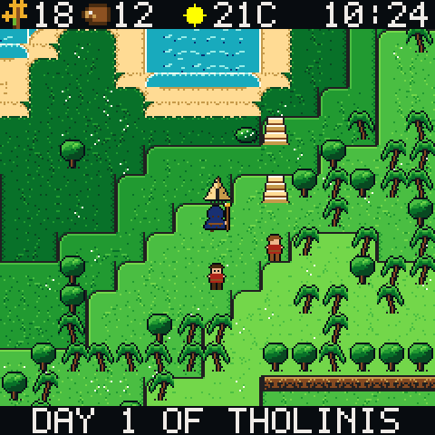 |  |
|  |  |  |

| Lake basin, northern | Archipelago, tropical | Mountain plateau, northern |
|---|---|---|
|  | 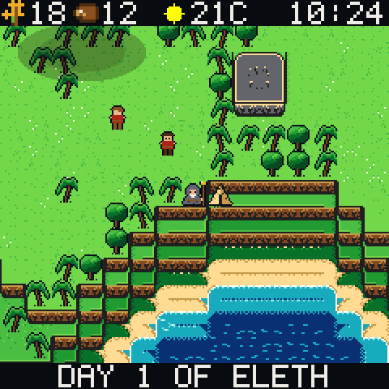 |  |
|  |  |  |

The four climates on the same island:

| Temperate | Savanna | Northern | Tropical |
|---|---|---|---|
|  |  | 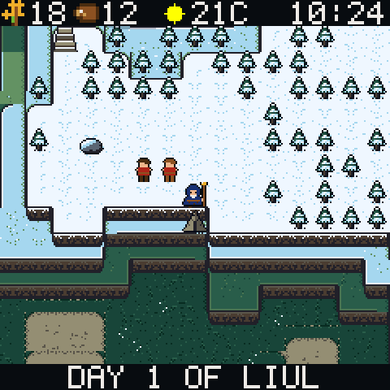 |  |

Terrain is drawn from 8x8 quarters that look at their own tile and the three that touch their corner, which gives rounded coasts and cliff
corners from about 70 pieces of art; a step up shows a cliff face on its south side. Heights come from fractal noise with a domain warp, so coasts and
cliffs are irregular. People and the shaman only move between equal layers or across **ramps** (a stair tile), never over a cliff.

| Villagers on a ramp (snow) | The shaman cutting a ramp |
|---|---|
|  |  |


## The village

Up to 48 villagers (6 bytes each). A game starts with one couple in a tent. A child grows up in 5 days; an adult lives 20 to 28 days (the last 5
as an elder, who prays). Couples have a child about every 3 days when there is a free bed and two days of food; a young couple settles every 3 days
while there is room (up to 36 villagers). Hunger is counted in missed meals (weak after 4, death after 6, 7 with a healer awake); thirst is
satisfied at a well or on the shore.

Jobs are chosen each morning by need: farmer, herder, fisher, lumberjack, builder, healer, water carrier, child, elder; each has its own tunic
and tool animation. Faith is made by awake adults every 30 minutes (elders count double, a shrine adds more, three food sources in a day make the
village content: 25% more faith).

| Building | Size | From | Beds / yield |
|---|---|---|---|
| Tent | 1x1 | start | 2 beds |
| Hut | 2x2 | 6 villagers | 4 beds |
| Cottage | 3x2 or 2x3 | 14 | 6 beds |
| Manor | 3x3 | 24 | 8 beds |
| Wheat field | 2x2 to 3x3 | start | 8 grain per harvest |
| Orchard | 3x2 or 2x3 | 8 | 8 fruit per harvest |
| Animal pen | 3x2 to 3x3 | 10 | up to 10 animals that breed when fed |
| Fishing hut | 2x1 or 1x2 | on a shore | fish |
| Well | 1x1 | start | water |
| Lumberjack hut | 2x2 | 4 | more wood per tree |
| Granary | 2x2 | 10 | food cap +100 |
| Shrine | 2x2 | 6 | +1 faith per half hour, praying elders count 3 |
| Infirmary | 2x2 or 3x2 | first sick villager | heals in 1 day (3 without) |
| Monument | 3x3 | 28 villagers, day 21 | the goal of the world |

A bigger home may replace tents and huts. Every water body has a fish stock (12 + 2 per tile, at most 250) that every catch depletes and that
grows back a tenth a day; animals die of old age and starve in lean spells, and breed again when fed.


| Town on day 20, river valley, tropical | Lake basin, savanna | Mountain plateau, northern |
|---|---|---|
| 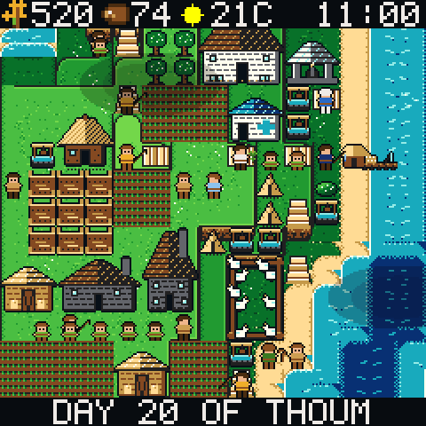 |  |  |

## The shaman

His seed gives him a personality (farmer, herder, fisher or builder) that biases what he builds first, and a **robe colour**: one of eight, different in every
new world and never the colour of the world before.

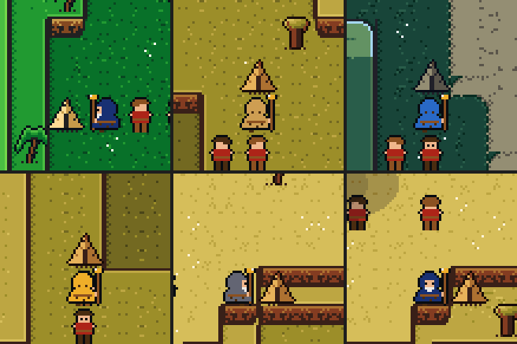

**Needs and projects.** Every 10 game minutes, when he is free, he scores food, housing, water, health, wood, growth (a flat plot, then a bigger home), faith (a
shrine) and the monument, and starts the most pressing project he can afford: lay out a building (levelling its plot first), dig a pond (on a world without a
coast), flatten a 3x3 plot for the next home tier, open wide flat land with spare faith, clear trees that shut a building in, or cut **ramps** (2 faith each) where
the village needs a way between layers. A site is the spot of lowest cost (faith to level and ramp, 2 per tile of walking from the green, penalties for reserved tiles);
spots the village could not walk to, or that would cut it in two, are refused, and one that the shaman cannot stand beside is turned down at planning, before any walk or faith.

**Terraforming.** One layer per cast; a step costs the number of the higher layer, an object costs 1, rock (layer 7) is never touched. Faith is paid when the staff
comes down and never goes below zero. Near the village neighbouring tiles differ by at most one layer, and after every project he cuts ramps until no cliff blocks a path.

| Terraforming | A pond dug on a world without a coast |
|---|---|
|  | 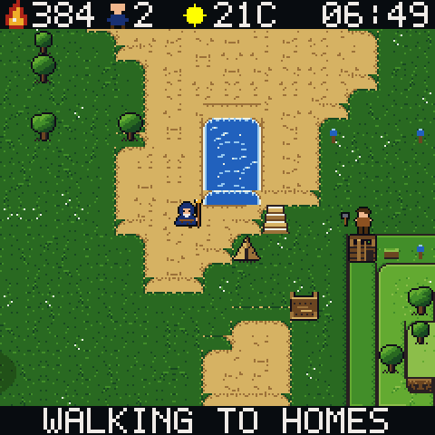 |

**He is always doing something visible, and the band says what.** When there is nothing to build he walks to a place with a meaning and stands there, praying or resting with a
raised staff and a small glow, then moves on: the shrine and the monument plot (PRAYING), the fields (BLESSING FIELDS), a home (VISITING VILLAGERS) and the green (RESTING),
with WALKING TO ... labels on the way; he never wanders aimlessly. While working the band reads WALKING TO SITE, LEVELLING LAND, DIGGING POND, FLATTENING PLOT, CUTTING RAMPS,
CLEARING TREES, BUILDING <name> or RAISING THE <monument>; while he waits, PRAYING FOR FAITH or WAITING FOR BUILDERS; at night GOING TO BED and SLEEPING.

| PRAYING | RESTING | BLESSING FIELDS |
|---|---|---|
|  | 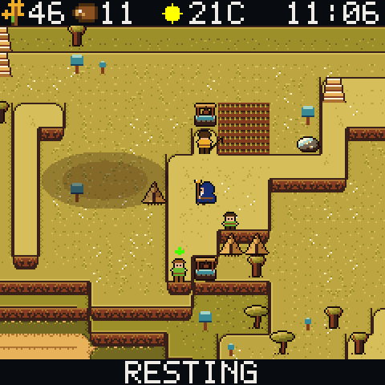 | 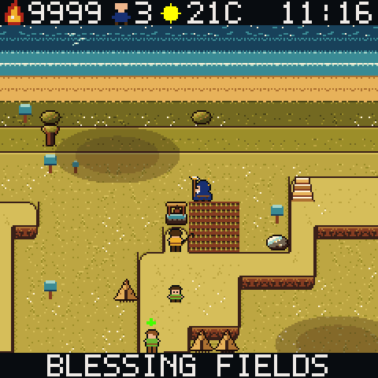 |

| WALKING TO SITE | LEVELLING LAND |
|---|---|
| 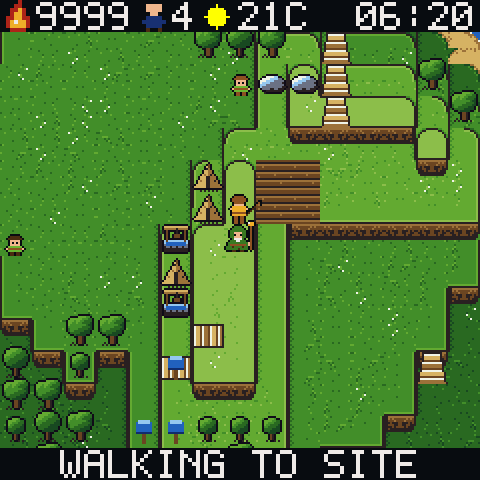 | 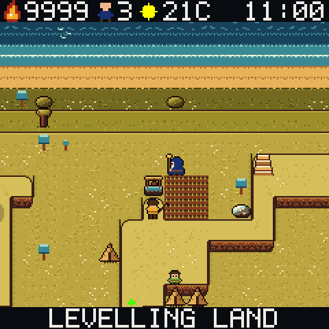 |

## Weather, sickness and wood

The weather is the live Open-Meteo reading (WMO weather code and temperature, every 30 minutes); with no reading the game is mild and dry (clear, 15 C).

| Weather | On screen | In the game |
|---|---|---|
| Rain, drizzle | animated rain, puddles | fields grow 50% faster, fishers catch 1 more, people outside collect exposure |
| Thunderstorm | heavier rain, lightning flashes | like rain, and everybody goes home |
| Snow | falling snow; it settles on the high layers and melts | fields stop, it counts as cold |
| Above 28 C | | thirst twice as often, water carriers (up to 3) |
| Below 8 C | chimney smoke | each occupied home burns 1 wood per night; a home without wood is cold |
| Fog | haze | none |
| Clear, cloudy, windy | cloud shadows drift over the land | none |
| Night (the clock's sleep schedule) | the map is dimmed | everyone sleeps |

| Rain | Thunderstorm | Snow on the high layers |
|---|---|---|
|  |  | 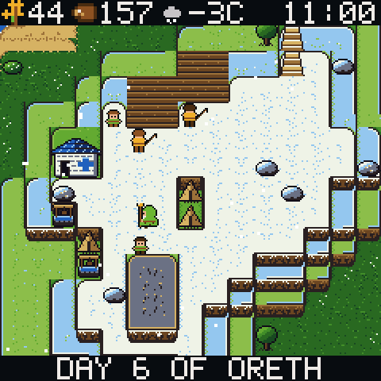 |

| Heat, water carriers | Cold night, chimney smoke | Fog |
|---|---|---|
|  |  |  |

| Cloud shadows | An infirmary with a sick villager | Lumberjack, stumps and saplings |
|---|---|---|
|  | 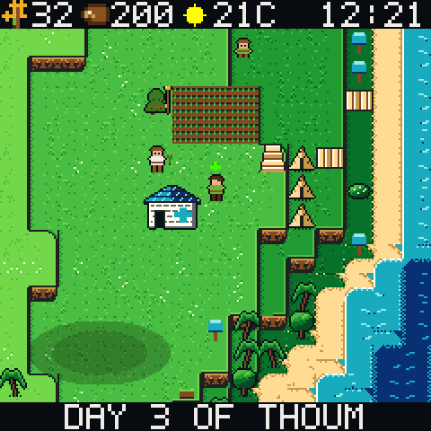 |  |

**Sickness.** At midnight every villager rolls against a risk of 1% plus missed meals, thirst, time outside in rain or cold, a cold home, and age. A sick villager does not work,
walks to the infirmary and wears a green tunic and cross; with an infirmary it is over at the next midnight, without one it takes 3 days, and a sick elder or weak villager may die.
The shaman builds the infirmary when the first villager falls sick.

**Wood.** A lumberjack fells a tree (3 wood, 4 with a lumberjack hut), leaves a stump and plants a sapling on it next time; a sapling is a tree after 4 to 5 days, the forest seeds more
(up to 36 trees and saplings), and lumberjacks leave the last 6 trees alone.

## The monument and the end of a world

A world has an arc: landing (days 1 to 3), village (4 to 12), town (13 to 24). From day 21, with 28 villagers, the shaman saves his faith and raises the monument in five stages, one every
2 days at the earliest, for 1300, 2200, 3200, 4500 and 6500 faith. Its type comes from the seed.

| Pyramid | Stone circle | Great tree |
|---|---|---|
|  |  | 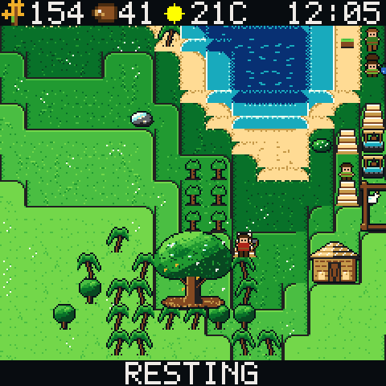 |

| Obelisk | Temple | Stage 3 of 5 |
|---|---|---|
| 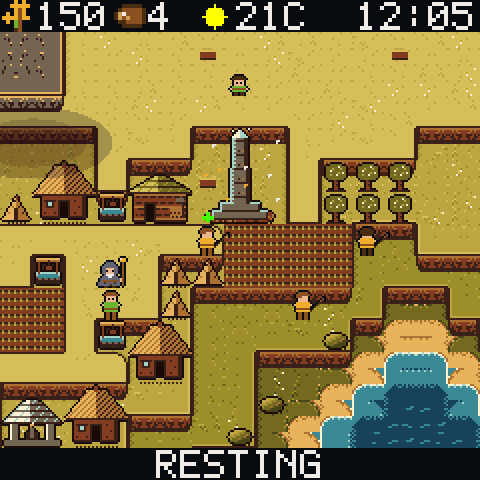 | 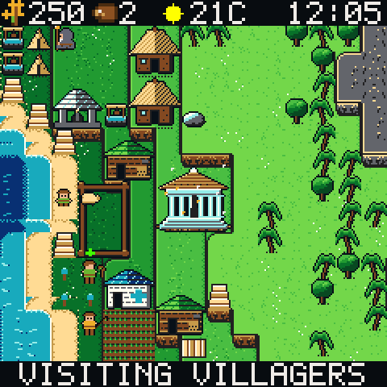 |  |

When stage 5 stands, the next day is the **worship day**: everybody gathers at the monument from dawn to 20:00. Then a **summary** (days, peak villagers, births, deaths, buildings)
stays on screen until the clock next wakes up, and a **new world** starts from a new seed, very different from the last (a village that dies out gets its summary within minutes).
The **Clock settings** page also has a **Start a new world** button.

| Worship day | Summary | Extinction | A town on day 35 |
|---|---|---|---|
| 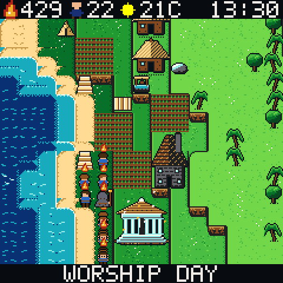 | 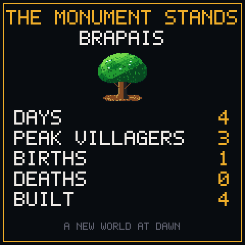 |  | 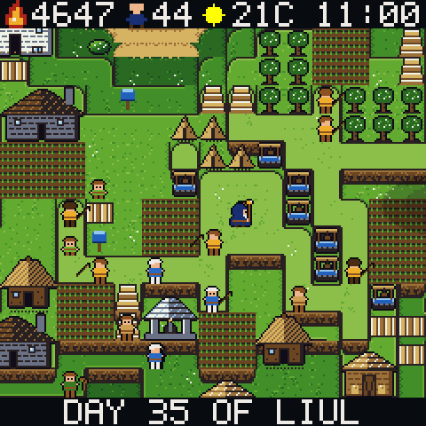 |

**Balance.** `python tools/balance_run.py` runs 100 whole worlds headless and fails unless no world ends before day 30, the median end is on day 30 to 45 and at most 3% die out (CI:
`balance.yml`). The distribution of the current release is in the release's pull request.

## Memory and cost

The game core and firmware use about 46.5 KB of static RAM (46152 bytes in r7, about 0.4 KB more in r8; CI prints the exact figure) (the 1 KB distance buffer shared by every search, the 1 KB map, villagers, buildings, weather, the shaman's 100 bytes), no heap, no libc, no floating
point. The whole game is saved to flash (1688 bytes in 6 parts, every villager, building, the map with felled trees and saplings, the monument and the statistics). The firmware size is
reported by CI with every build (the cap is 470 KB for the game; the stock updater needs the image under 500 KB).

## Hardware

- GeekMagic SD Pro / SmallTV-style clock: ESP8266 (ESP-12, 4 MB flash) with a 240x240 ST7789
  display.
- Display wiring (from the [GeekMagic-Open-Firmware](https://github.com/Times-Z/GeekMagic-Open-Firmware)
  teardown): hardware SPI mode 3 at 40 MHz, MOSI 13, SCLK 14, DC 0, RST 2, CS tied to ground,
  backlight on GPIO 5 (active LOW).
- No serial adapter is needed or assumed. Everything is installed and recovered over WiFi.

## The clock's web pages

Open `http://<clock IP>/`. The status page shows firmware, WiFi, network health, memory and
uptime. **Update firmware** and **Clock settings** are buttons in the first tile, **WiFi setup** is
in the Network tile.

**Update firmware** (`/update`): choose a `.bin` by hand, or press **Check for a new version**: your
browser (not the clock) asks GitHub (`techconcert/MiniGodus`) for `latest.json` on the `builds`
branch, tells you if a newer build exists, and **Download it** loads the file into the page for you;
you then press **Upload and install**. The clock itself never talks to GitHub. The same checks run on
the file as for a manual upload.

**Clock settings** (`/config`):

- **Weather:** search a city (foreign places work), or type latitude and longitude. Celsius is the
  default, Fahrenheit is an option. The clock asks [Open-Meteo](https://open-meteo.com/) (free, no
  account, plain HTTP) every 30 minutes and shows the icon and temperature on the top bar.
- **Sleep:** a sleep time and a wake time. The shaman walks to his bed, the screen and game go
  dark, the CPU slows down, and the clock keeps the time. At the wake time everything comes back by
  itself. **Sleep now** and **Wake now** buttons are there too. WiFi, the web pages and the update
  page stay on while asleep.
- **Location and time zone:** the city search also fills the time zone rule (converted in your
  browser, no firmware cost); you can still type the rule text by hand.
- **Screen:** brightness, colour depth, the weekly maintenance restart and the display test.
- **Save settings** and **Reset these settings** on this page touch only this page's settings.

The status page has a **Game settings** section (info card interval, quiet at night) with its own
Apply and **Reset game settings** buttons, which touch only those two settings.

## Recovery and the rescue hotspot

Every build contains, and CI refuses to produce a `.bin` without (`tools/check_bin.py`):

- **The update page starts first.** WiFi and the web server start before the display or the game,
  so a game bug cannot hide the update page.
- **Rescue hotspot** `MINIGODUS-XXXX`, password `MINIGODUS`, at `http://192.168.4.1/`. It is on for
  the first 10 minutes after every power-on and whenever the clock cannot find your WiFi. The
  WiFi page (`/wifi`) lets you enter your network again.
- **Crash-loop safe mode.** After 3 crashes in a row (or 5 in total without 6 hours of uptime in
  between) the clock boots without the game and shows SAFE MODE; after 6 it also skips the
  display. The update page still works.
- **Automatic restarts:** after hours without WiFi, with very low memory, and once a week at night.
  They never happen while a firmware upload is running, are rate limited, and count towards safe
  mode like any restart.
- **Size limit.** The ESP8266 holds the running firmware while receiving the next one, both inside
  a 1 MB area. CI fails any build over 500 KB, so updates always fit, including going back to
  stock.
- **Stock files are never touched.** Same flash layout as the stock firmware; the code never writes
  flash by itself (only the update page's Updater does), and CI forbids EEPROM, LittleFS and SPIFFS
  code. Flashing `SDPro_V1.0.6_....bin` from the MiniGodus update page brings the original clock
  back.
- **One flash area.** The clock saves its settings and the world in sectors 0x80000-0x82FFF (three
  4 KB sectors, between the running image and a staged update). Nothing else is ever written: not
  0x3FA000 (stock data), not 0xFF000, no EEPROM, LittleFS or SPIFFS. CI enforces this
  (`tools/lint_safety.py` rules L2 and L14). See "Saving to flash".

## Saving to flash

`firmware/store.cpp` keeps a ring log of records in the three sectors 0x80000 to 0x82FFF. A record is 6 slots of 320 bytes
(`lib/gamecore/src/reclog.h`): settings (48 bytes), weather and sleep settings (64), and the whole game (1688 bytes, in 6 parts: the
head with the world, the statistics, the monument, the fish stocks and the seed history; then the villagers, the buildings and the map, 5 bits a
tile). Every slot has its own CRC, the record's sequence number and a CRC over all 1800 bytes; a record is valid only when
all 6 slots agree. The newest valid record is loaded at boot (the game is streamed into the core one slot at a time, so there is no 1.7 KB buffer),
and a power cut in the middle of a write leaves an invalid record, so the previous complete one loads (tested with power cuts at every kind
of point: `test/test_reclog.cpp` on the log, `test/test_store_sim.py` on the real store.cpp over a simulated flash). The erase only ever
takes the sector that holds the two oldest records, never the newest one or the one before it. Each sector is erased once per 6 saves
(about 12 times a day at a save every 20 minutes: 100 000 cycles last more than 20 years). Writes are rare: settings 5 seconds after a change,
the game every 20 minutes, at each new game day and 5 seconds after a new world, at most 6 writes in 10 minutes; every slot is read back, the whole
record is checked once more, and 3 failures switch saving off. Nothing is written in safe mode, while a firmware update runs, or when the image is
larger than 0x7D000 bytes. After 2 or more crashes the saved game is kept aside, not loaded, and the settings are still saved with the old game
carried over unchanged, so a game that crashes the clock cannot crash it again from the save. An r5 record (one slot, version 4 game) is still
read and upgraded by the first save. Updating to a new MiniGodus build keeps everything; flashing the stock firmware does not (not needed).
The status page shows "Saved to flash ..." or "Loaded from flash ..." lines.

**GeekQuest shares this flash area.** The clock's WiFi, weather and sleep settings are common to
both firmwares, but the saved game has its own magic number in each: MiniGodus' is `MGOD`
(`GQ_SAVE_MAGIC` in `lib/gamecore/src/gq_types.h`), GeekQuest's is `GGQS`. A game saved by the other
firmware fails the magic check and is ignored, so switching the clock between GeekQuest and MiniGodus
never loads the other's game; the next save simply replaces it. `test/test_save.cpp` checks this.

Gates: `tools/lint_safety.py`, `tools/check_bin_selftest.py`, `tools/check_bin.py` on every `.bin`,
a size report, and `tools/recovery_guard.py` (a `RECOVERY-CHANGE:` commit line and a new
`GQ_RECOVERY_REV` whenever a recovery file changes).

## Build and test

Firmware (PlatformIO, ESP8266 Arduino core):

```
pio run -e quest        # the game  -> dist/SDP_MiniGodus_quest_<version>.bin
pio run -e test         # display test build (the only one with the test scene)
```

Host tests (no ESP8266 needed; run every `test/*.cpp`):

```
for t in test/*.cpp; do
  g++ -std=c++17 -O1 -g -fsanitize=address,undefined -fno-sanitize-recover=all -Wall -Wextra -Werror \
    -o /tmp/$(basename $t .cpp) $t lib/gamecore/src/*.cpp lib/gqsafe/src/*.cpp && /tmp/$(basename $t .cpp) </dev/null
done
python3 tools/lint_safety.py && python3 tools/lint_safety.py --selftest
python3 tools/check_bin_selftest.py
for t in test/*.py; do python3 $t; done      # includes the store simulation (real store.cpp on a simulated flash) and the VERSION check
python3 tools/balance_run.py                 # 100 simulated worlds, a few minutes
```

Browser preview (clang with wasm32 and lld): `tools/build_preview.sh` writes `preview/dist/index.html`.
The preview is the same game core as the clock, plus a debug panel that is not in the firmware:
a seed picker (type a seed and press **Load seed** to see exactly that world), a monument stage, worship day, summary and extinction panel, a **New world** button (random seed,
never the same landform and climate as before), menus to force a landform or climate, live weather, sleep mode,
WiFi state, jump to a day, and time scale.

Art: tiles and sprites are `assets/src/*.png` on a 16x16 grid with the 16-colour palette in
`tools/palette.py`. After editing run `python tools/png2tiles.py`. The r2 world art is made by
`python tools/make_world_art.py` (terrain quarters painted with roles, trees and boulders, the shaman, the top bar icons),
which you can also edit by hand afterwards; the climate palettes are in `tools/palette.py` too. The README pictures come
from `python tools/make_screenshots.py` (it builds `tools/shots.cpp`, a host renderer that uses the real game core).
Python tests: `python3 test/test_art_tools.py`. The r4 building sprites (`village.png`, ids in `village_art_ids.h`) are drawn by the same script.

## Repository layout

```
firmware/        ESP8266 entry (main.cpp), ST7789 driver, recovery layer (safety.cpp, netwatch.cpp), prefs.cpp,
                 weather (wxnet.cpp), sleep schedule (nightmode.cpp), settings page (config.cpp), flash save (store.cpp)
lib/gamecore/    portable game core (no heap, no libc), used by the firmware and the preview:
                 world.cpp (generator, autotiler), godus.cpp (scene, camera, shaman's walk and staff, top bar),
                 village.cpp (villagers, buildings; shaman.inc.h is the shaman's brain: needs, site search, terraforming;
                 nature.inc.h: forest, fish; savepack.inc.h: the village's share of the saved game), reclog.cpp (flash record log)
lib/gqsafe/      pure decision code of the recovery layer (boot counters, WiFi ladder, upload checks)
assets/src/      editable PNG sheets (terrain quarters, objects, shaman, icons, and the r1 sheets)
tools/           asset converter, version stamp, .bin safety checks, source lint, CI guards
firmware/config_page.h  source of the /config page; the firmware serves the gzip copy in config_page_gz.h (run tools/gen_config_gz.py after editing it, CI verifies)
docs/            design (DESIGN.md), the owner's recovery guide, screenshots/
preview/         browser preview (WebAssembly)
```

The `GQ_` prefix on code names (settings, events, queries) is a leftover from the project this
firmware grew out of and is kept so the recovery layer stays byte-for-byte comparable.
